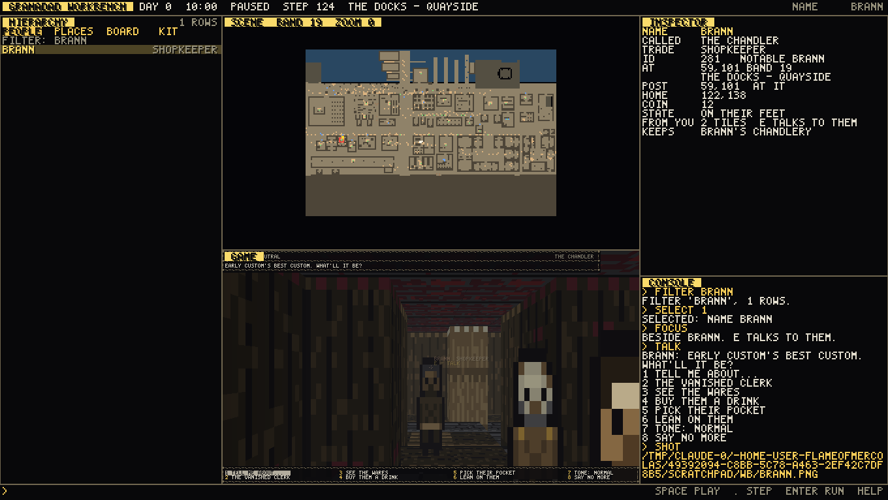
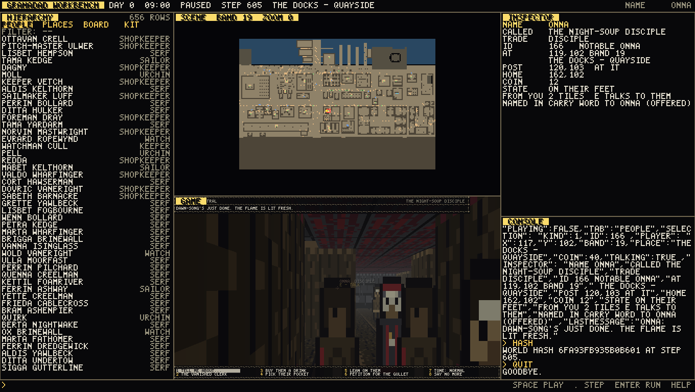

# The Workbench -- a Unity-shaped editor over the live ward

*(Added 2026-10-09. Status: **BUILT** headless and tested; the window mode is **BUILT,
NOT YET RUN** -- it compiles against the same raylib backend the game's window uses,
but the session that wrote it had no display. The owner's first launch is its first
run.)*

`granadad-workbench` is a separate program that holds one live, running Granadad
world and shows it six ways at once, the way Unity's editor shows a scene. Everything
it does goes through the same public verbs the game itself calls -- it is a hand on the
real simulation, never a second one beside it -- so what you see in it is what the game
does.



```
+---------------------------------------------------------------------------+
| TOOLBAR   day, clock, PLAYING/PAUSED, steps run, where the player is      |
+---------------+---------------------------------+-------------------------+
| HIERARCHY     | SCENE   the ward from above:    | INSPECTOR  what the     |
|  PEOPLE  656  | every body a dot in its trade's | selection is, in the    |
|  PLACES   55  | colour, the player a yellow     | sim's own words: post,  |
|  BOARD        | wedge, the selection ringed     | home, coin, errands,    |
|  KIT          +---------------------------------+ counter, who E answers  |
|  (filterable) | GAME    what the player sees    +-------------------------+
|               | (640x360, the software          | CONSOLE  every command  |
|               |  raycaster) with the HUD and    | and every answer, and   |
|               |  any open conversation          | what the ward said      |
+---------------+---------------------------------+-------------------------+
| > the command line                                                        |
+---------------------------------------------------------------------------+
```

## Starting it

```
.\dist\granadad-workbench.exe              # the window (Windows, after the gate)
.\dist\granadad-workbench.exe --time=21    # the world boots at nine at night
granadad-workbench --script=look.wbs       # run commands, print answers, exit
granadad-workbench --serve=wbdir           # one world, many workflows (below)
```

The gate installs it beside `granadad.exe`. On a headless (Memory-platform) build there
is no window, and the program says so and points at `--script` and `--serve`.

## In the window

| | |
|---|---|
| click a hierarchy row | select it |
| click a tab word (PEOPLE PLACES BOARD KIT) | switch the list |
| click a body (or a place) in SCENE | select it |
| mouse wheel | scroll the list, or zoom the scene |
| `UP` / `DOWN` | walk the list (with an empty command line) |
| `SPACE` | play / pause the world (with an empty command line) |
| `.` | step the world once |
| type anything | the command line; `ENTER` runs it, `ESC` clears it |

## The commands

The same words in the window, in a `--script` file and in a served `.cmd` file.

| | |
|---|---|
| `step [N]` | run the world N steps (default 1) with nobody touching the keys |
| `hour HH` | wait to that hour, the WAIT page's own call |
| `play` / `pause` / `speed N` | the window's clock: N steps a frame while playing |
| `tab people\|places\|board\|kit` | what the hierarchy lists |
| `filter TEXT` / `filter` | narrow the list by name or trade; clear it |
| `list` | print the list (first 60 rows) |
| `select N` | row N of the list (1-based) |
| `select person NAME\|#ID` | anybody in the ward, by name or id |
| `select place NAME\|#N` | a signed door or way |
| `select errand ID` / `select item ID` | a board row; a Kit row |
| `next` / `prev` / `select none` | walk the list; back to the player |
| `inspect` | print the inspector |
| `zoom 0-3` | the scene's zoom; it follows the selection |
| `focus` | put the player beside the selected person (on a tile E answers them from), at a place's door, or beside an errand's giver or target |
| `talk` | press E: open the conversation and print the topics |
| `topics` / `topic N` / `leave` | the topic list; pick N (1-based); end the talk |
| `goto X Y [BAND]` / `face n\|e\|s\|w` | place and turn the player |
| `coin N` / `give ITEM [N]` | set the purse; put things in the Kit (TAKE's own load rule) |
| `shot PATH` / `pane NAME PATH` | write the whole frame, or one pane (`scene`, `game`, `hierarchy`, `inspector`, `console`, `toolbar`), as a PNG |
| `state` / `hash` | a one-line JSON summary; the world hash |
| `save NAME` / `load NAME` | a SCENE (below) |
| `echo TEXT` / `help` / `quit` | |

## Scenes: saving what you did

A scene is not a snapshot of memory. It is the **log of every world-changing command
since the world booted** -- steps, waits, focuses, talks, topics, coins, gifts, and the
selections they acted on -- written as a plain text file. `load` boots a fresh world and
replays it, and because the simulation is deterministic (the twin-run gate's whole
promise) the replayed world lands on the **identical world hash**. That is pinned by
`test_workbench.cpp`. Scenes go to `./workbench-scenes/NAME.wbs` (or `--scenes=DIR`),
never into `content/`. A scene file is also a script: edit it by hand, run it with
`--script`.

## Serving: many workflows, one world

```
granadad-workbench --serve=wbdir
```

keeps one world alive and watches `wbdir/inbox/`. Any number of workflows -- a person
with a shell, a FEATURE agent, a SCORER agent, a CUSTOMER agent -- drop command files
there, each with its own name:

```
wbdir/inbox/0042-feature.cmd      step 600 / select person onna / focus / talk
wbdir/inbox/0043-scorer.cmd       state / hash
```

They run in name order, against the same world. Each one's answers land in
`wbdir/outbox/<name>.out`; the file moves to `wbdir/done/`; and after every batch the
**shared view** is refreshed for everybody: `wbdir/frame.png` (the whole workbench, as
above), `wbdir/state.json` (clock, steps, selection, player, the inspector's lines) and
`wbdir/log.txt` (everything, in order). One workflow's command shows up in the next
one's picture -- that is the point. A `quit` command ends the server.



## What it is not, yet

- **The GAME pane is the software raycaster**, not the 3D scene: the 3D backend owns
  one window and one camera, and a second 3D view inside a pane is a renderer job of
  its own. The raycaster is the same world, the same people and the same HUD.
- **It edits by acting, not by painting.** Nothing it does writes `content/`; changing a
  map is still Tiled's job, and changing a raw is still a text editor's. What it adds is
  a place to SEE the live ward -- who is where, what the board holds, what E would say
  -- and to put the world into a state and keep it as a scene.
- **The window has not been run.** Every pane, the mouse's hit-testing, the command line
  and the serve loop are exercised headless by `test_workbench.cpp`; the window's own
  event loop is a thin shell over them, compiled but unrun until the owner opens it.
