# Phase 7 (retire the old renderer): every scripted line, before and after

Phase 7 of `docs/design/OBLIVION-PLAN.md` deletes the software world pass and `--2d`.
Before it could go, every scripted `--screenshot` line of `granadad --help` was run on
both sides and compared.

| | Revision |
|---|---|
| before | `main` at `11743646` (after phase 6), Debug, Linux, headless on Mesa llvmpipe |
| after | this branch, same build, same machine |

`lines.txt` is the list: one row per scripted line of `--help` (each of its WHERE words
where it has several), 154 rows. `shoot.sh` runs it through a binary, always as

```
granadad --smoke=0 --hold --width=640 --height=360 --scale=2 <the row's flags> --screenshot=NAME.png
```

and writes `results.tsv`. [`results.tsv`](results.tsv) here is the two runs joined.

## What the comparison shows

* **All 154 lines land their capture on both sides**, exit code 0 each time (the lines
  fail with a non-zero exit when a scripted run falls short, so this is the check that
  each one still drives its scenario to the end).
* **The 3D scene hash is identical in all 154**. The shutter prints the hash of the
  whole `SceneDescription` (chunks, sky, people, hands, camera): it is the 3D frame's
  input, so the world every line photographs is the same world, byte for byte.
* **104 of the 154 PNGs are byte-identical**. The other 50 differ only in the thin band of
  the frame where a name sign stands (at most 5,836 changed pixels of 921,600 in any one
  frame, in small boxes where the signs land): see "The one thing that was not covered",
  below.

(`--selftest`, `--ward`, `--people` and the other lines of `--help` that print and
exit draw nothing and are not renderer lines. `--padscript`, `--padcreation`,
`--framedump`, `--demo*` and `--case-watch*` need a window and a pad and are not
runnable headless; the 3D shutter they and the windowed loop share is the one every
row above goes through.)

## The one thing that was not covered

`render3d` did not draw the **world-space name signs** ("THE GILDED GULL" over the
Gull's door, "TARWALK" at the street post, 83 in all). They were the software pass's:
`drawSignage` decided whether a sign was visible by reading the depth buffer the software
world pass wrote, and in the 3D build the frame it draws on is an overlay with no depth, so
it read "sky" everywhere and drew nothing. `--2d` was the only way to see a nameplate.

Deleting `--2d` without fixing that would have deleted the signs. So `Session::drawFrame`
now hands the signage the lens's own line of sight over the tiles (`cameraSightClear`,
the walk the scripted shots already use to aim, not the sim's person-to-person rule),
and `drawSignage` skips a sign whose wall is behind another wall. The 50 PNGs that differ are
exactly the frames where a sign is in range and in sight: they now carry it, as the old
software frame did. The proof that nothing else moved is the scene hash above.

## Before and after

Both sets are the same command line, viewport (1280x720 after the 2x upscale), clock and
state. Only the signs differ.

| | Before (`main` `11743646`) | After (this branch) |
|---|---|---|
| Street, noon (`--time=12`) | 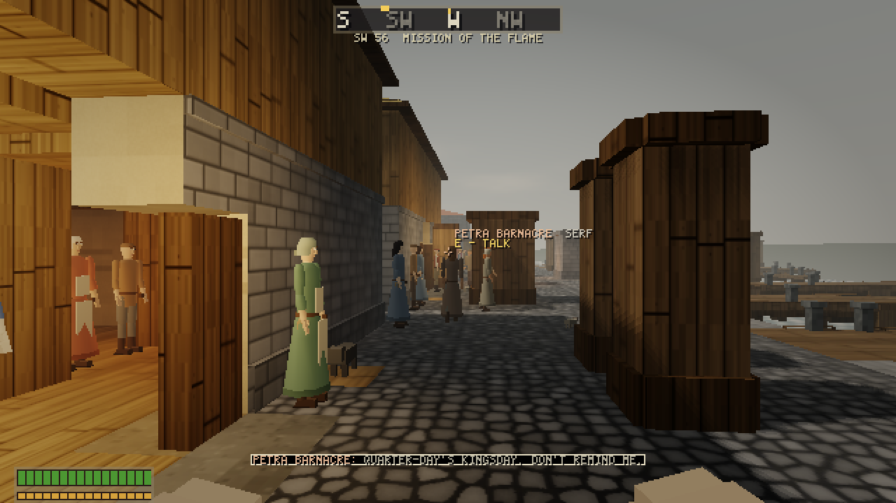 |  |
| Street, dusk (`--time=19`) | 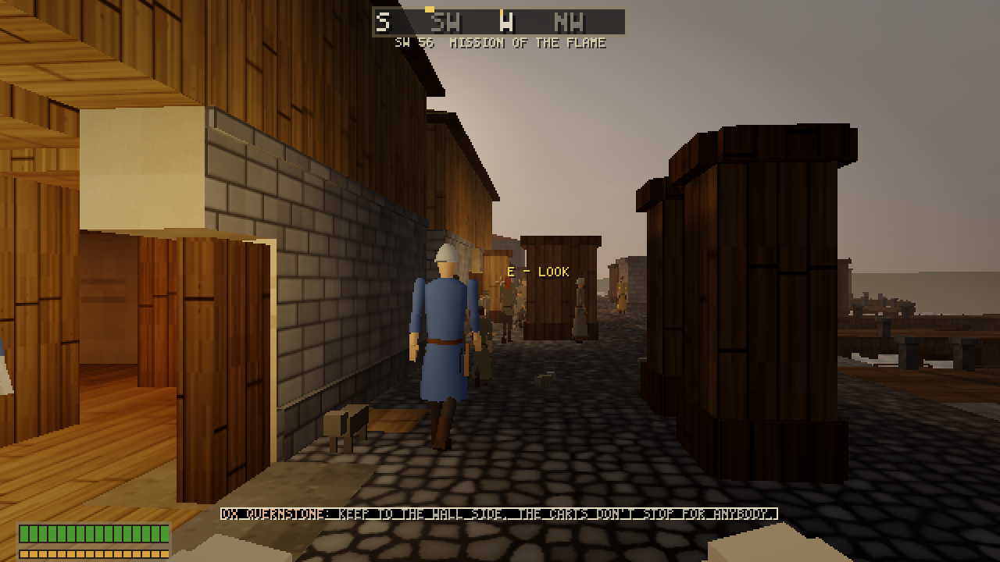 |  |
| Street, night (`--time=22`) | 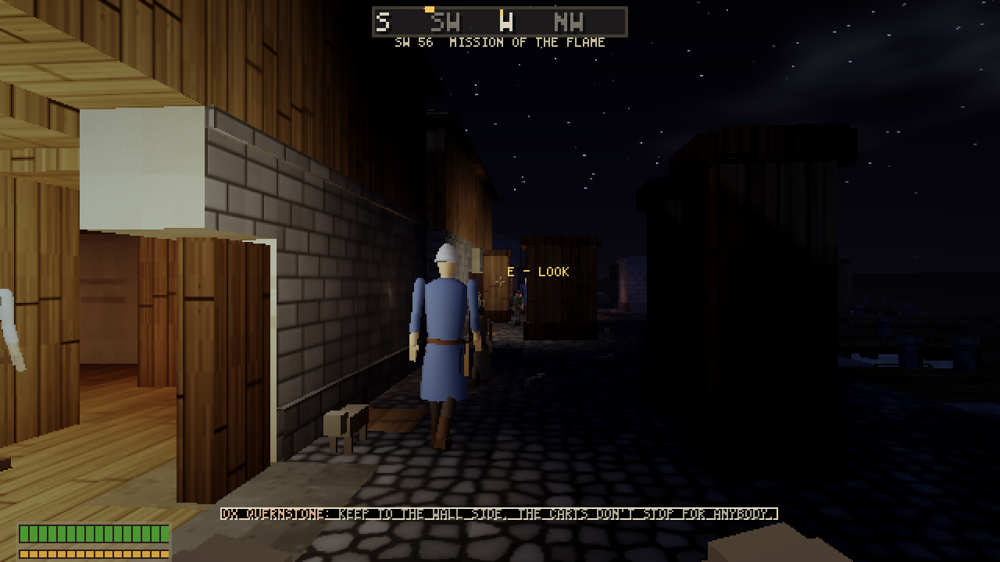 | 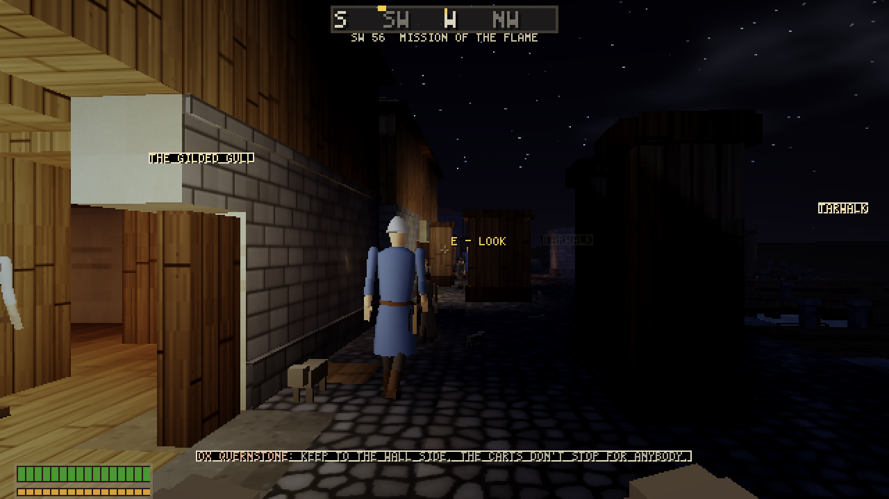 |
| The piers (`--threshold=piers --time=9`) |  | 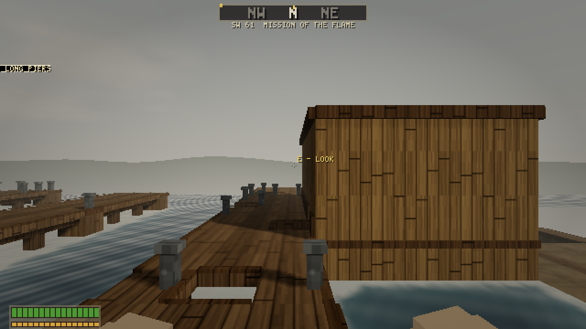 |
| Saltgate (`--threshold=saltgate --time=9`) |  | 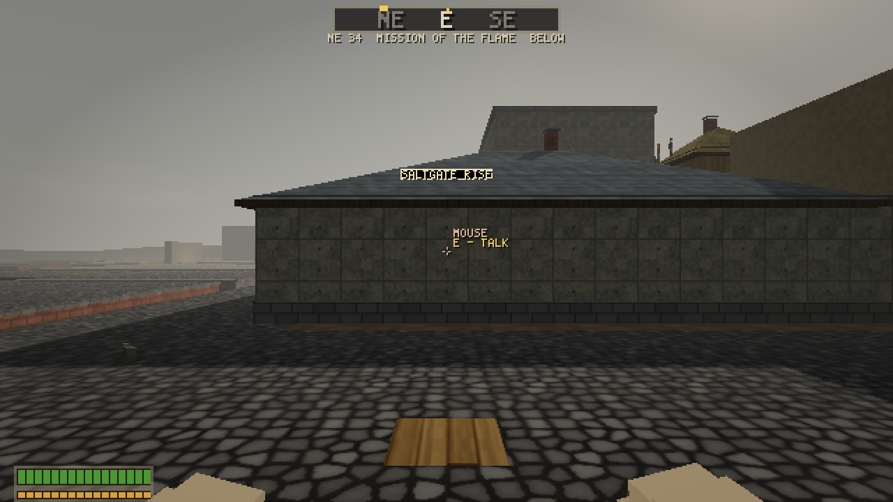 |
| In conversation (`--talk`) |  | 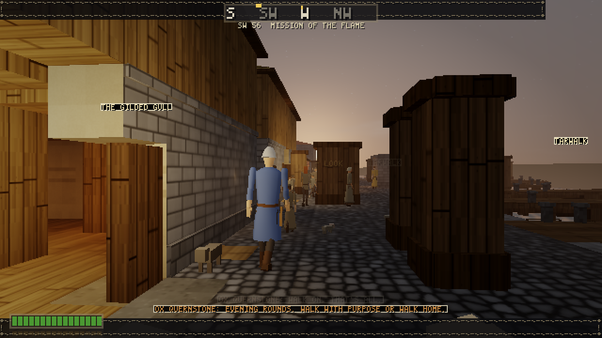 |
| Facing the Gull (`--face="The Gilded Gull"`) | 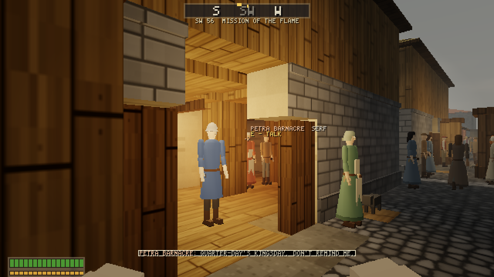 | 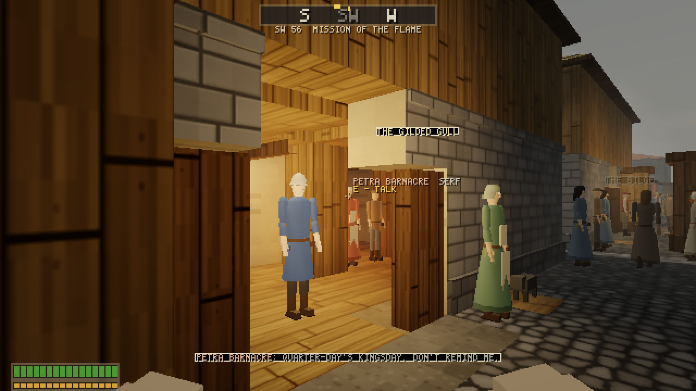 |
| A passer-by speaks (`--voice=pass`) |  | 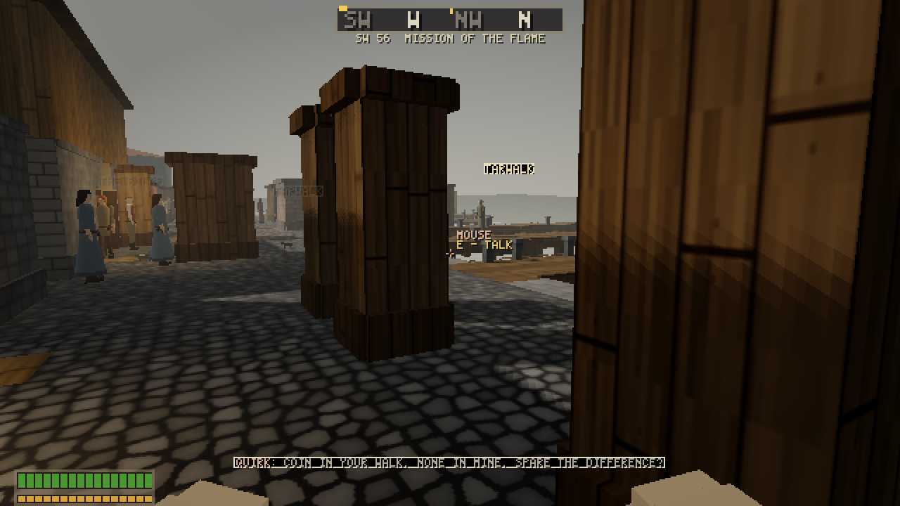 |

## The workbench game pane

`granadad-workbench`'s GAME pane drew the software raycaster. It is the 3D world now, with
the game's own HUD over it. Same script on both sides:

```
hour 12
select person brann
focus
shot PATH
```

(`granadad-workbench --script=FILE`, 1360x768.)

| Before (`main` `11743646`) | After (this branch) |
|---|---|
| 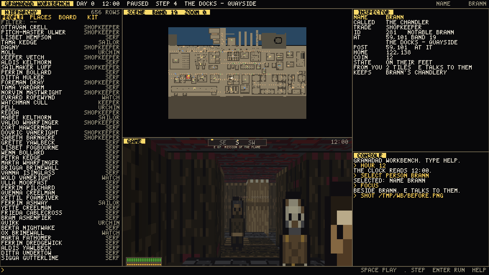 | 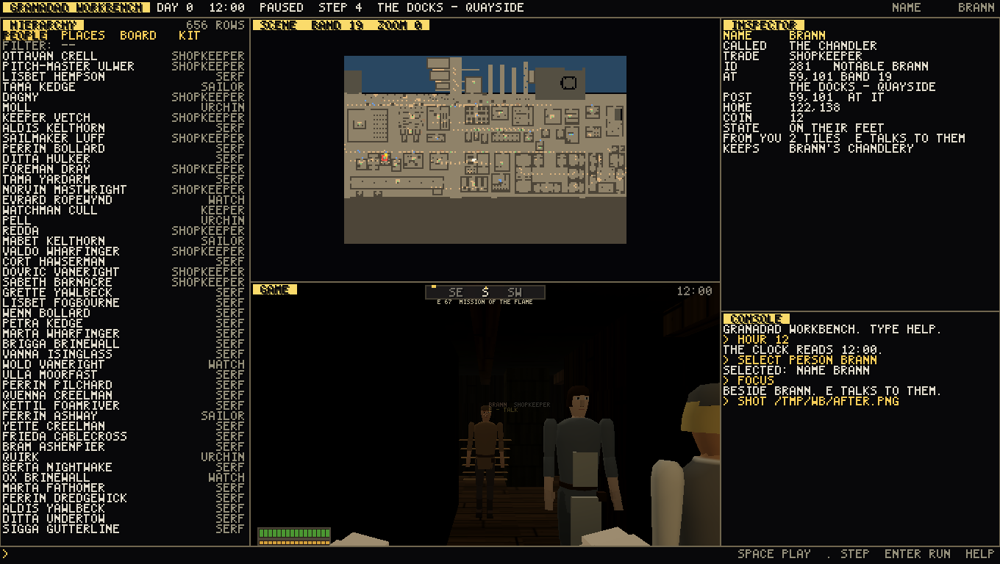 |

The window itself (`granadad-workbench` with no flags, where the backend puts the world in the
pane's rectangle) was not run: this machine has no display and no GPU, only the headless path
above. That needs a look on Windows.
