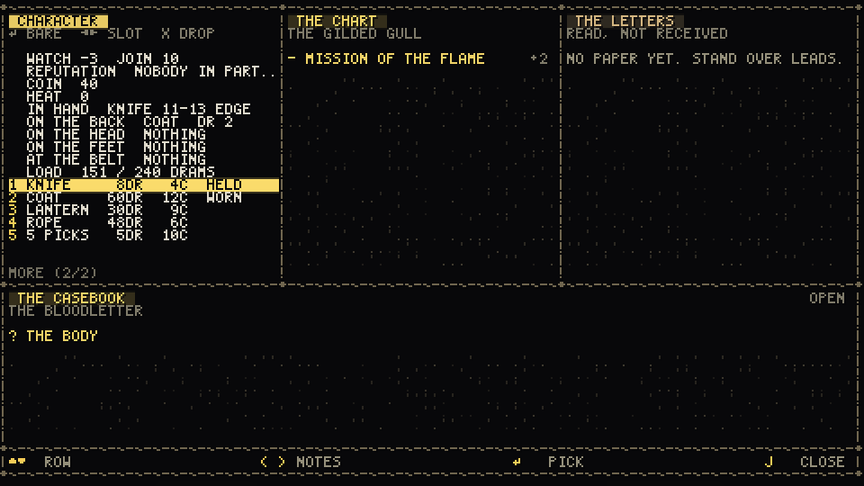
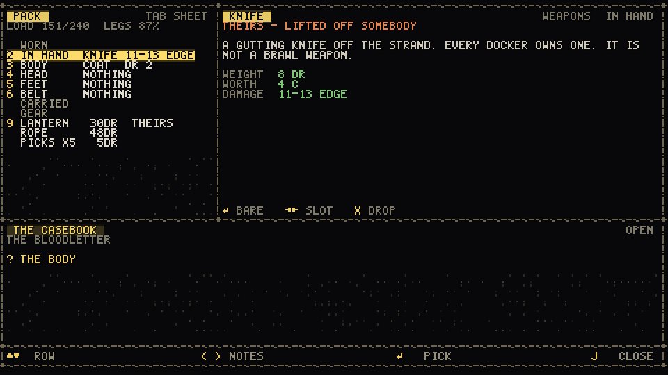

# Phase 8 (inventory): the pack, before and after

Phase 8 of `docs/design/OBLIVION-PLAN.md` (section 8.2): carry, inspect, drop, pick up and use items
on top of `sim/items` and `content/raws/items`, with an inventory screen that reads clearly.

| | Revision |
|---|---|
| before | `main` at `128af014` (after phase 7), Debug, Linux, headless on Mesa llvmpipe |
| after | this branch, same build, same machine |

Every frame is 960x540, scale 1, the same clock (two in the afternoon) and the same state, drawn by a
scripted line that plays the real verbs. `shoot.sh BEFORE_BINARY AFTER_BINARY` reshoots the set. The
Linux build has no Synty art tree, so the 3D frames behind the Menu are the placeholder frame; the
screens themselves are the real UI.

## The comparison: the same body, the sheet and the pack

`--kit=equip` on both builds: the coat on the back, the knife in the hand, the lantern, the rope and
the picks in the pack. The "before" inventory is the tail of the Character sheet, behind two pages of
standings, one row per thing with weight and worth. The "after" is the same body on the pack
(`--kit=pack`, the equip beat's tile stepped from the sheet with `TAB`).

| Before (`main` `128af014`, `--kit=equip`) | After (this branch, `--kit=pack`) |
| --- | --- |
|  |  |

The sheet is still there and `--kit=equip` on this branch draws it as before; the only change on it is
the `TAB PACK` hint on the badge row ([`after/equip-sheet.png`](after/equip-sheet.png)).

## The pack line, `--pack[=WHERE]`

Six beats through the real verbs, every ending a stop on the way. The summary line prints its own
counts (`pack beats=6/6 ...`) and the run exits non-zero when a beat falls short.

| frame | line | what it shows |
| --- | --- | --- |
| [`pack-take.png`](after/pack-take.png) | `--pack=take --settle-steps=0` | The quay's two bandages and two loaves taken off the boards by the crosshair. Nobody's, so no crime: `bandage=2 bread=2`, none of it THEIRS. |
| [`pack-theirs.png`](after/pack-theirs.png) | `--pack=theirs --settle-steps=0` | Four in the morning in the empty Gull: the house's ale and bread off the bar, the knife and the coat. The last press reads `TAKEN - COAT. THEIRS. NOBODY SAW.` |
| [`pack-list.png`](after/pack-list.png) | `--pack=list` | The pack: WORN (hand, body, head, feet, belt), then CARRIED grouped CONSUMABLES and GEAR. The coat and knife are worn through the pack's own press and not listed twice. THEIRS marks what was lifted. |
| [`pack-use.png`](after/pack-use.png) | `--pack=use` | A hurt body, the cursor on the loaf: the detail pane with its numbers, `1 OF 3` lifted, and `EAT` on the foot. |
| [`pack-ate.png`](after/pack-ate.png) | `--pack=ate` | `ENTER`: one loaf spent, the body mended by 12, the stack at x2. |
| [`pack-load.png`](after/pack-load.png) | `--pack=load` | The load at its budget, the legs slowed (`LEGS` on the epithet), the rope highlighted. The weight is **given** here (`giveItem` until the budget is full): no stand on the quay is heavy enough to show the overload row, the line's one staged beat. |

## What the screen is

The Character tile has two views, stepped with `TAB` (`LT`/`RT` on a pad; the badge row says which).
The sheet is what it was. The pack is the list on its own:

* **WORN**, then **CARRIED**; carried rows are grouped by what a thing is (WEAPONS, ARMOUR,
  CONSUMABLES, GEAR, GOODS) and in registry order inside a group. The headings are not rows to stand
  on: the cursor steps over them and they print no number.
* The epithet is the load, always (`LOAD 125/240`), and `LEGS n%` once the weight slows the body.
* The chart's and the letters' room becomes one **detail pane** for the highlighted row: its name and
  group, what it is, weight and worth (one and the stack), a hand item's span, a worn piece's DR, what
  a use does, the Watch's heat, its quick slot, and `THEIRS - LIFTED OFF SOMEBODY` when it was.
  The foot lists the keys that act on it.
* The verbs are the sheet's: `ENTER` (or `E`, or `A`) wears or bares a worn thing and **uses** a
  consumable, `LEFT`/`RIGHT` walk the quick slot, `X` drops one.

## The three new things, in the simulation (integers only)

* **Consumables** (`content/raws/items/items_consumables.json`, read after `items.json`, which is
  never edited): bread (mends 12), ale (mends 4 and MIGHT +1 for 300 s) and a bandage (mends 30).
  A use is the spells' own integer vocabulary and nothing else (a mend through the dose a healing
  link lands, a tuning as a held effect `effectiveAttributes` already reads); one unit is spent; a
  mend on a whole body is refused and the unit is kept. A second ale refreshes its hold whole.
* **THEIRS** is state: the Kit remembers how many units of a row were lifted, hashed and in the codec
  (version 2; version 1 images still decode).
* **Stands**: two loaves and two bandages on the quay (nobody's), a loaf and an ale in the Gull (the
  house's). `docks-pieces-items.json` dresses them with files the item table already draws.

There is no lantern-oil flask, which the plan names as an example: nothing in the ward burns a held
lantern's fuel yet, so the row's use would do nothing.

## The baseline, declared

The tavern twin moves, once, for one reason; the population twin does not.

| `granadad-twin-gate` (Linux, GCC 15, Debug) | before | after |
| --- | --- | --- |
| `--tavern --ticks 900`, run A == run B | `0x63F354D02A6B600F` | `0xB36BFF03C7603051` |
| `--tavern --ticks 900`, with `items_consumables.json` removed | | `0x63F354D02A6B600F` |
| `--population --population-hour 16 --ticks 7200`, run A == run B | `0x499B2D62A49840B5` (23,419 bytes) | `0x499B2D62A49840B5` (23,419 bytes) |

The move is the four new ground stands joining the hashed ground list. The Kit's own hash is written
so rows an extra raws file adds, and stolen units, only join it when held: with the new file removed
the tavern twin is the old number exactly. Re-blessing on Windows/mingw (`verify-windows.ps1`) is
Liefwarrior's step; it has not been run here.
